# CiberDeck — MS ROBOTIKA

Aplicación Android local para comprobar, observar y documentar dispositivos propios o autorizados, con ESP32 opcional. Conserva el proyecto CyberDeck, paquete y funciones anteriores. El nombre visible vuelve a **CiberDeck**; la rama `feature/superflyper-usb-v0-1` conserva su nombre por continuidad. [PR de desarrollo #1](https://github.com/msrobotika/MSA-CyberDeck/pull/1), sin fusionar en main ni publicar una release.

## Desarrollo 0.37 · «Analiza mi red wifi»

La petición reconoce también «red Wi-Fi» y «red inalámbrica», y se puede enviar desde la entrada inicial o como tarea nueva desde el seguimiento. Consulta la conexión real de Android sin cargar el modelo ni conectar un ESP32, y muestra qué transporte está usando. Las peticiones desconocidas reciben una explicación visible cuando no está disponible la IA. Es un diagnóstico local de conexión, no una auditoría de seguridad. [Cambios y validación](docs/VALIDATION-037.md).

Instalada y probada en A15: **266 pruebas JVM y 18 casos Android correctos**, incluida la frase exacta escrita y la transcripción controlada de Android. Dictado humano y actualización del OPPO pendientes.

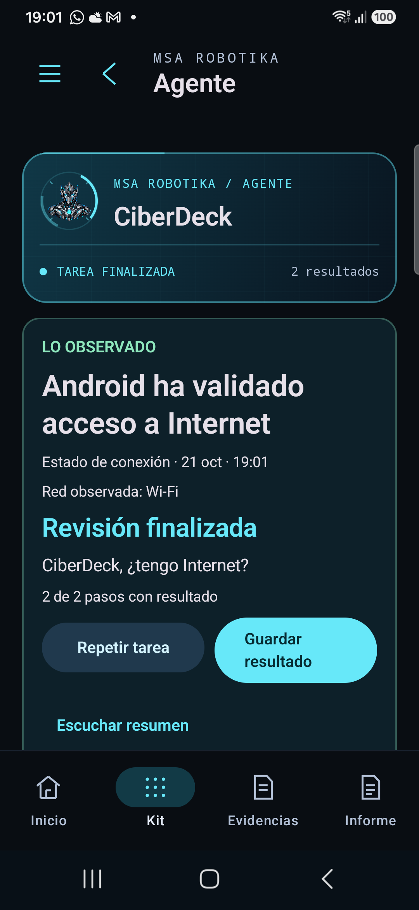

## Desarrollo 0.36 · Continuar la tarea

Resultado principal más compacto, acciones de repetir/guardar y seguimiento «repítelo», «guárdalo» o «muéstrame los detalles». Repetir crea una lectura nueva para planes locales permitidos; los demás planes requieren revisión y nueva autorización de red. Guardar confirma tras verificar la copia con SHA-256. **262 pruebas JVM y quince casos Android correctos**, compilación sin errores, instalada y probada en A15 con repetición, guardado real y ausencia de duplicados. [Implementación y límites](docs/VALIDATION-036.md).

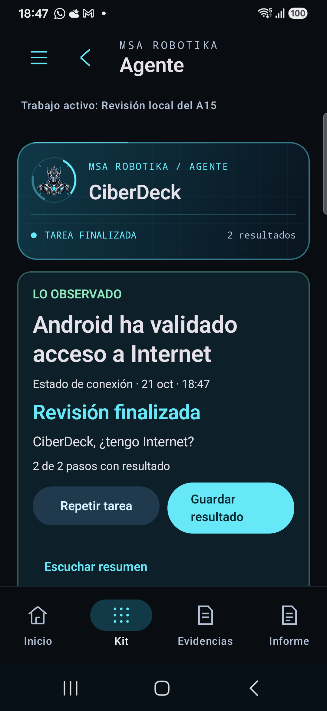 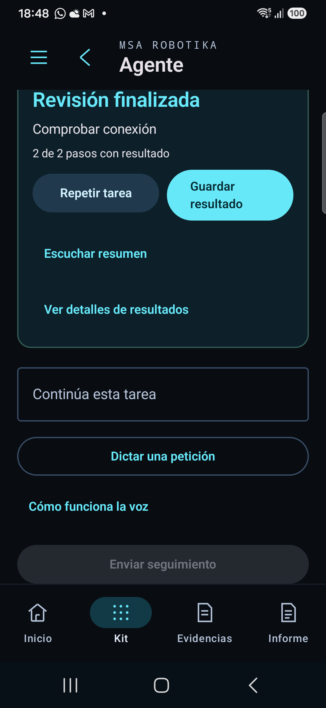

## Desarrollo 0.35 · Asistente de campo

Cabecera compacta durante la tarea, progreso del controlador real, «Nueva petición» sin mezclar el resultado anterior, conversación temporal de cinco tareas y respuesta hablada opcional al terminar. Reutilizar solo rellena el borrador; no repite operaciones. Memoria en RAM, separada del modelo. Instalada en A15 y OPPO: **257 pruebas JVM, trece casos Android en A15 y seis casos Android en OPPO correctos**, incluidos conversación y control de voz tras recreación. Dictado humano y audición física pendientes. [Implementación y límites](docs/VALIDATION-035.md). Las imágenes históricas inferiores conservan su versión.

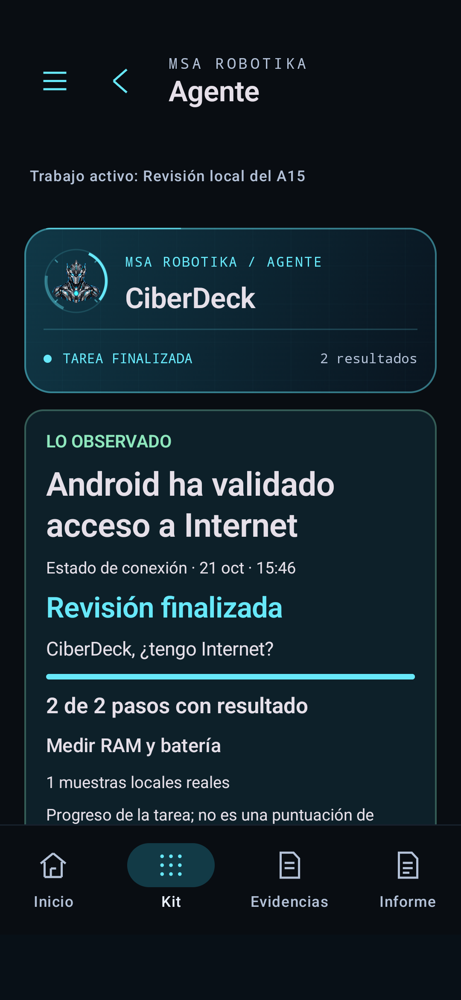 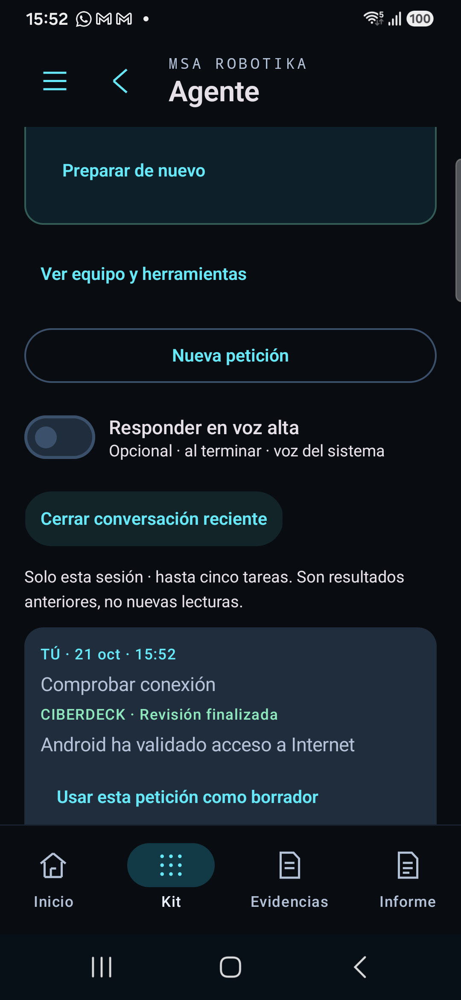

[Entrada del agente](docs/screenshots/ciberdeck-agent-command-035.png) · [Petición recuperada como borrador](docs/screenshots/ciberdeck-followup-035.png) · [Control de voz](docs/screenshots/ciberdeck-voice-035.png).

## Desarrollo 0.34 · Petición dictada y medición real

«Mírame el campo magnético del cuarto de baño» reconoce la herramienta local sin cargar IA; mide donde está el teléfono. El borrador sobrevive a la recreación de la pantalla y las peticiones no reconocidas muestran el aviso junto al botón. La respuesta destaca el valor real en µT. **252 pruebas JVM y once casos Android correctos en A15**; el resultado del contrato de dictado se ensaya con texto, el sensor es físico. Micrófono hablado y actualización del OPPO pendientes. [Corrección y método](docs/VALIDATION-034.md).

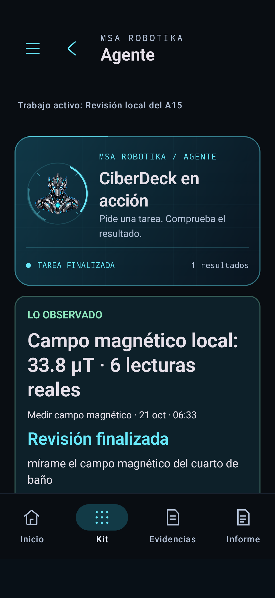

## Desarrollo 0.33 · Hablar con CiberDeck

Consola futurista con robot original, estados de ejecución y voz y contador de lecturas auténticas. Los aros son decorativos, no un radar. El agente reúne peticiones por texto o dictado de Android, tareas directas más naturales y lectura explícita de un resumen breve. La transcripción queda como borrador; las tareas con destinos o red siguen necesitando sus datos y autorización. El equipo técnico se despliega después del resultado. Se mantiene la IA local para las peticiones compatibles que requieren planificar. [Implementación, voz y límites](docs/VALIDATION-033.md).

Instalada en Samsung A15 Android 16: **248 pruebas JVM y nueve casos Android correctos**. Dictado hablado y audición física pendientes; se comprobó la síntesis mediante callbacks del motor.

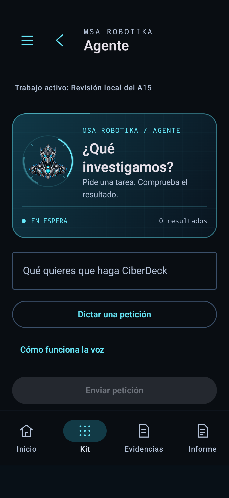 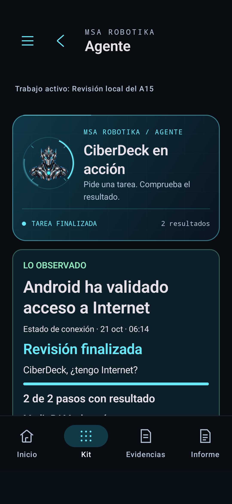

## Desarrollo 0.32 · De la observación al siguiente paso

La revisión del móvil empieza en modo guiado: prioridades reales, una observación a la vez, acción relacionada y nueva lectura para comprobar qué cambió. Los paneles técnicos siguen en «Todos los datos y herramientas». No convierte datos ausentes en amenazas ni abrir un ajuste en una corrección. [Recorrido y límites](docs/VALIDATION-032.md).

Instalada en OPPO Android 16: **237 pruebas JVM y siete pruebas Android correctas**. [Resumen guiado real](docs/screenshots/ciberdeck-guided-summary-032.png) · [Siguiente paso y nueva lectura](docs/screenshots/ciberdeck-guided-step-032.png).

## Desarrollo 0.31 · Menos pasos

Inicio se centra en tres acciones: revisar el móvil, pedir ayuda al agente y ver cambios. El resto aparece al desplegar «Más herramientas y actividad» o desde el kit. La revisión de cambios arranca al entrar y sus valores se consultan dentro de cada tarjeta; la comparación completa sigue disponible. Guardar el resumen queda junto al resultado, antes de la lista. [Cambios y límites](docs/VALIDATION-031.md).

Instalada en A15: **234 pruebas JVM y ocho casos Android correctos**, con las rondas y ajustes de ensayos documentados.

[Inicio simplificado en A15](docs/screenshots/ciberdeck-home-031.png) · [Resumen de cambios](docs/screenshots/ciberdeck-investigation-031.png).

## Desarrollo 0.30 · Misión «¿Qué cambió?»

Inicio ofrece una investigación local de las lecturas guardadas: verifica las copias, reúne parejas del mismo tipo y destino y muestra los cambios con sus fuentes. Las barras cuentan campos textuales; no representan riesgo. Cada pareja se puede abrir en Comparar y el informe de misión conserva referencias y SHA-256 sin copiar los valores originales. No genera tráfico ni necesita IA. [Implementación y límites](docs/VALIDATION-030.md).

Instalada en A15: **234 pruebas JVM y cinco pruebas Android correctas**. [Captura real de la misión](docs/screenshots/ciberdeck-investigation-030.png). El detalle de qué botones se han probado y cuáles quedan pendientes está en el informe de validación.

## Desarrollo 0.29 · Inspección de QR

«Enlaces y QR» lee un código desde una imagen elegida, identifica su tipo y analiza localmente los enlaces HTTP(S). Puede reconocer configuraciones Wi-Fi, contactos y otros esquemas sin conectarlos, importarlos o ejecutarlos. El contenido completo se oculta por defecto; el informe conserva metadatos y huella de imagen, sin el payload completo ni claves Wi-Fi. El agente incorpora «Lee un QR de una imagen» usando el selector Android mediante la acción LINK.

APK 0.29 instalada en A15: **226 pruebas JVM y 15 pruebas Android correctas** con el teléfono desbloqueado. Comprobadas lectura nativa, privacidad, mostrar/ocultar/descartar QR, navegación y tareas del móvil. Comprobados también el selector real de Android y el guardado del informe sin SSID ni contraseña. El flujo QR completo del agente continúa pendiente de prueba física. [Implementación, pruebas y límites](docs/VALIDATION-029.md).

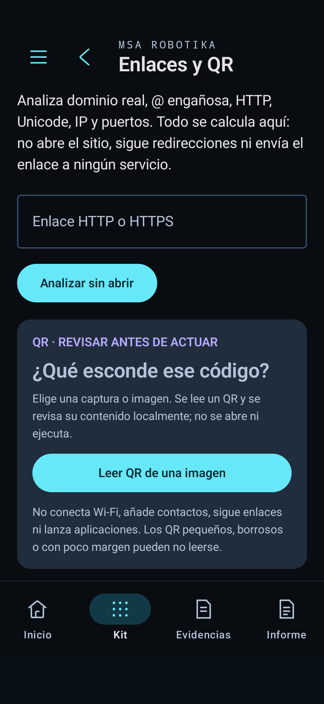

## Desarrollo 0.28 · Identidad visual de campo

Rediseño visual de la portada y el kit: robot con mayor presencia, retícula decorativa, seis acentos de área, iconos vectoriales propios, tarjetas de altura compartida por fila y condiciones de uso en etiquetas. Se mantienen las rutas, permisos, resultados y sus fechas; las animaciones no representan lecturas ni conexiones.

Rediseño comprobado en A15 con **216 pruebas JVM y diez casos Android**, incluyendo un ajuste del desplazamiento del ensayo para componer la fila antes de pulsarla. Cinco capturas reales revisadas y conservadas por versión. [Implementación, rondas, contraste calculado y límites](docs/VALIDATION-028.md).

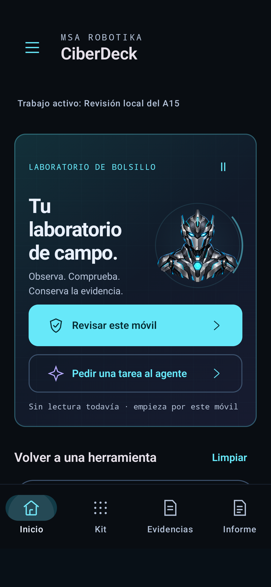 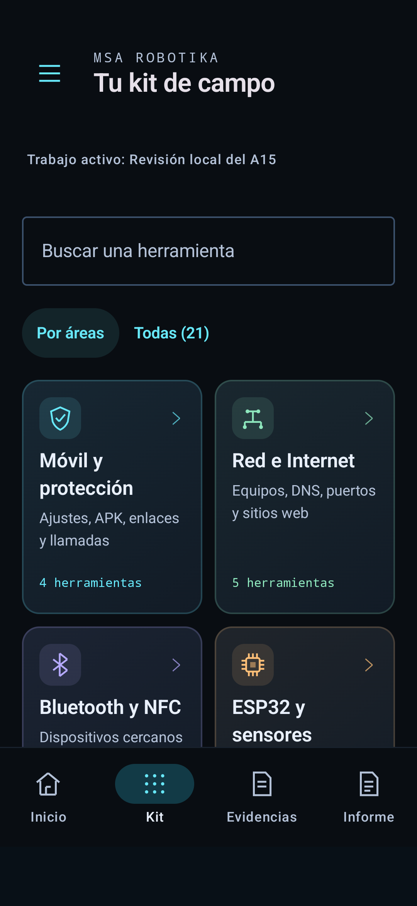 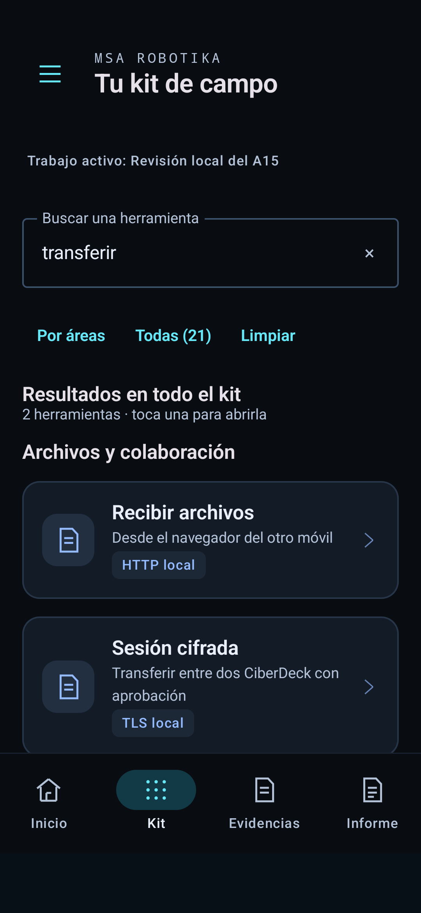

## Desarrollo 0.27 · Resultados primero

Red y web presentan resumen, destino, fecha y guardado antes del formulario. Los campos técnicos se despliegan y se pueden buscar sin recortar el informe original. «Copiar resumen» incluye la fecha y el destino; no copia los campos técnicos. La última observación pasa a la sesión para conservarse al recrear la actividad y la vista vuelve al resultado cuando llega una lectura.

APK 0.27 instalada en A15. **216 pruebas JVM correctas y 16 casos Android comprobados**: áreas/búsqueda, recientes, foco del agente, conservación del plan, filtro/guardado del resultado y retención de lectura al recrear la actividad. Una expectativa antigua del ensayo de navegación se actualizó para respetar el formulario plegado; los cuatro casos afectados de seguimiento pasaron. Compilación y lint sin errores. OPPO no conectado. [Método, rondas y límites](docs/VALIDATION-027.md).

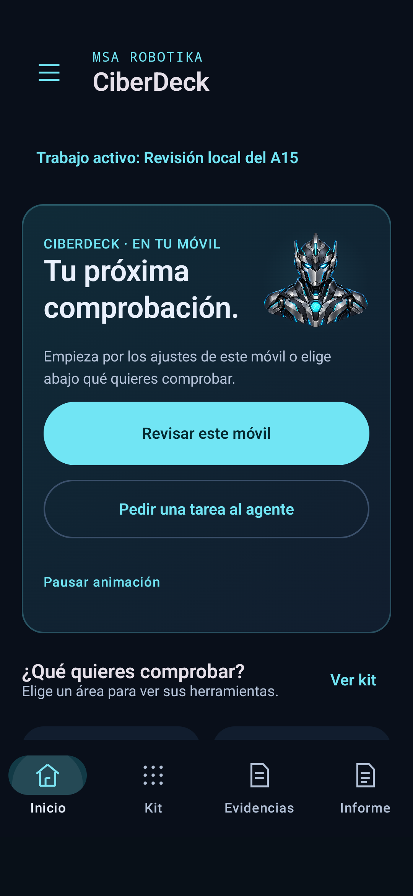 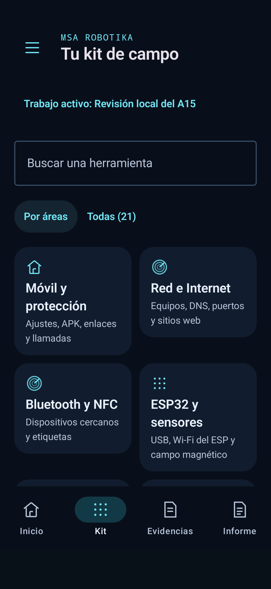 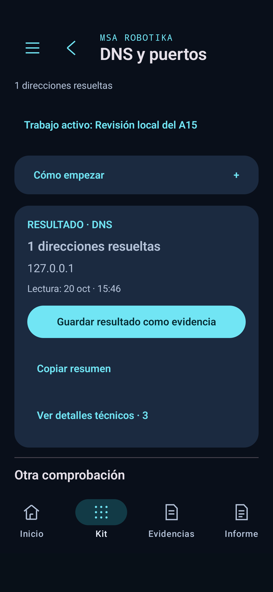

[Búsqueda por tareas](docs/screenshots/ciberdeck-search-027.png) · [Revisión real del móvil por el agente](docs/screenshots/ciberdeck-agent-027.png). Capturas del A15 con la APK 0.27; el diagnóstico DNS usa `127.0.0.1`. Las capturas históricas inferiores conservan su versión.

## Desarrollo 0.26 · Una tarea cada vez

El agente muestra el plan o el resultado sin mantener desplegado el formulario de nuevas tareas. «Elegir otra tarea» abre el selector y permite volver sin sustituir la sesión actual. Inicio ofrece las tres herramientas más recientes; «Limpiar» solo retira esos accesos. Seis herramientas incorporan una guía plegable «Cómo empezar» con requisitos, pasos y resultado esperado.

APK 0.26 instalada en A15, conservando datos y modelo. **210 pruebas JVM correctas**, compilación y lint sin errores. Pruebas táctiles de 0.25/0.26 y capturas nuevas pendientes del desbloqueo del A15; OPPO no conectado. [Implementación y límites](docs/VALIDATION-026.md).

## Desarrollo 0.25 · Elegir una tarea

Inicio con una acción principal para revisar el móvil y acceso al agente. El kit se divide en seis áreas compartidas con el inicio: móvil, red, proximidad, hardware, archivos y agente. La búsqueda encuentra tareas por términos comunes, recorre todo el catálogo y permite volver al área elegida. Las 21 herramientas existentes siguen accesibles desde «Todas» y el menú lateral.

APK 0.25 instalada en A15 conservando datos. **207 pruebas JVM correctas** y compilación correcta. Las pruebas táctiles y capturas nuevas están pendientes: el A15 está bloqueado. OPPO no conectado. [Cambios, validación y límites](docs/VALIDATION-025.md). Las imágenes inferiores pertenecen a sus versiones indicadas.

## Desarrollo 0.24 · Fuentes primero

«Revisar fuentes · sin IA» prepara y guarda una instantánea fechada de Android y de la fuente elegida, sin cargar un modelo. El resumen procede de código; declaraciones del usuario, resúmenes y texto generado conservan su procedencia. La interpretación de IA se abre por separado y queda plegada por defecto. Esto no elimina los errores del modelo.

El equipo del agente es compacto: nombre y estado por especialista, operaciones desplegables y último resultado con acceso al detalle completo. Los ajustes del modelo quedan plegados sin ocultar errores ni progreso. [Método, pruebas y límites 0.24](docs/VALIDATION-024.md).

Instalada en A15: **200 pruebas JVM y 12 pruebas Android correctas**; limpieza del ensayo de guardado comprobada por separado. OPPO pendiente de conexión para esta versión.

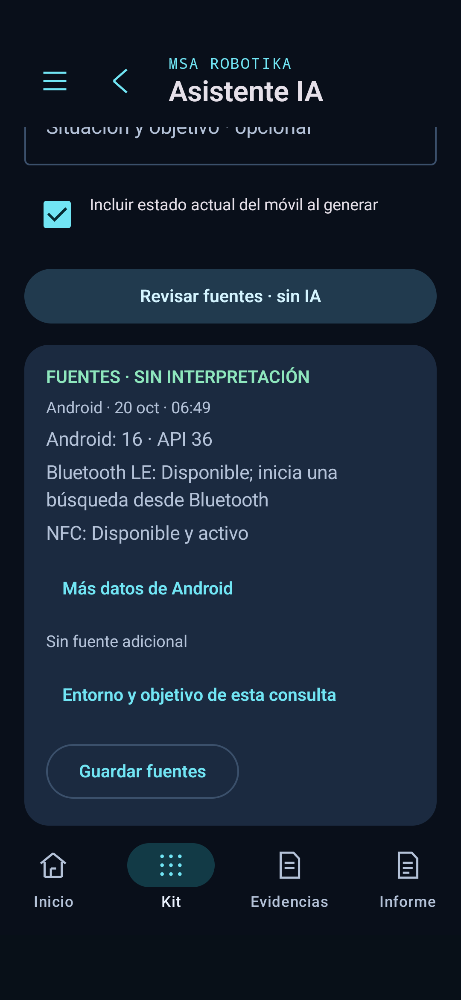 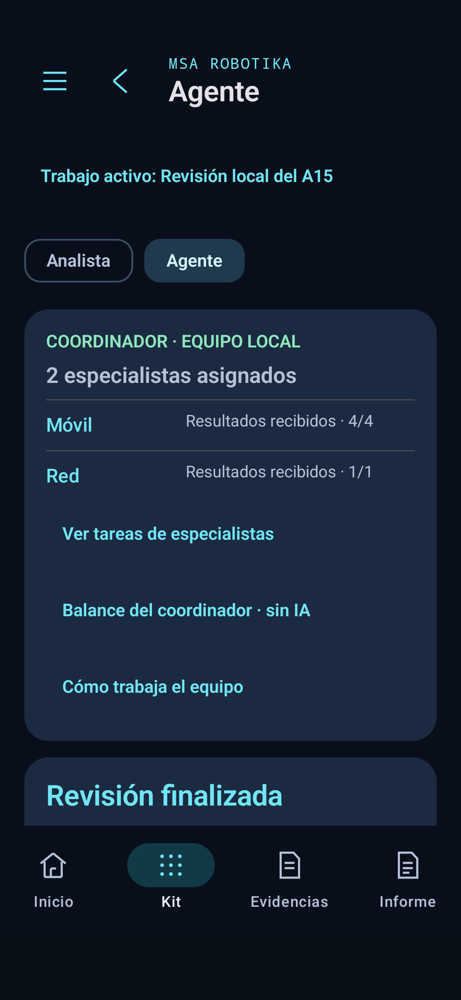

## Desarrollo 0.23 · Coordinador y especialistas

El agente delega las treinta herramientas entre trabajadores de Móvil, Red, Sensores, Hardware, Evidencias y Analista. El panel muestra solo los necesarios y sus estados reales. Se conserva el orden del plan; errores y cancelaciones detienen el resto. Un solo motor local, sin seis modelos cargados ni razonamiento independiente por trabajador. El balance final es código, no una conclusión generada. Versión instalada en A15: 190 pruebas JVM, dos pruebas Android de ejecución/modelo y seis pruebas de interfaz correctas. Capturas reales del equipo y balance disponibles. La respuesta del analista sigue conteniendo inferencias sin respaldo, incluso con el muestreo nuevo. Temperatura 0,01 y top-k 1 reducen variación, sin garantizar exactitud. [Implementación, pruebas y límites](docs/VALIDATION-023.md).

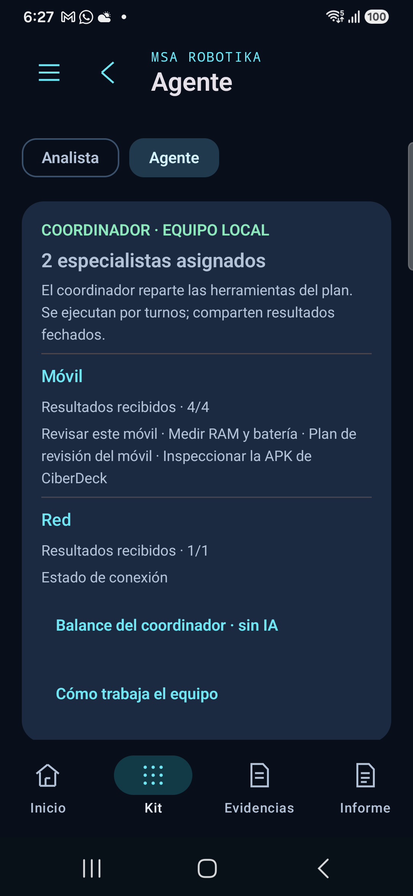

## Desarrollo 0.22 · IA con contexto local

APK candidata para Android 8 o posterior **de 64 bits** (ARM64/x86_64). Instalada en Galaxy A15: compilación y lint correctos, pruebas de lógica y validación Android descritas en el informe. El OPPO no está conectado y no se ha actualizado en esta revisión. [Validación 0.22](docs/VALIDATION-022.md).

**Contexto de IA**: describe la situación y el objetivo, elige una lectura/evidencia o el resumen del agente e incluye opcionalmente una instantánea Android obtenida al generar. El analista recibe fuentes fechadas y pide observaciones, interpretación justificada y siguiente comprobación. Puedes consultar y guardar la entrada exacta enviada al motor con su SHA-256. No supone entrenar un modelo nuevo ni garantiza razonamiento experto; la prueba real todavía mostró inferencias sin respaldo sobre permisos. Las respuestas requieren revisión.

El magnetómetro sigue siendo una herramienta de observación local: no evalúa exposición laboral o riesgo sanitario. El ejemplo de un taller junto a un transformador incorpora esa limitación tanto en la interfaz como en la consulta. [Alcance, fuentes y pruebas](docs/VALIDATION-022.md).

**Resultados primero**: al ejecutar, el agente muestra un resumen con progreso medido, síntesis de cada paso y guardado de la sesión. Los métodos y lecturas completos se despliegan al pedirlos. Distingue errores, interrupciones, interpretaciones de IA y pasos manuales u omitidos; terminar herramientas no es una puntuación de seguridad. «Preparar de nuevo» conserva el origen del plan y no repite operaciones automáticamente.

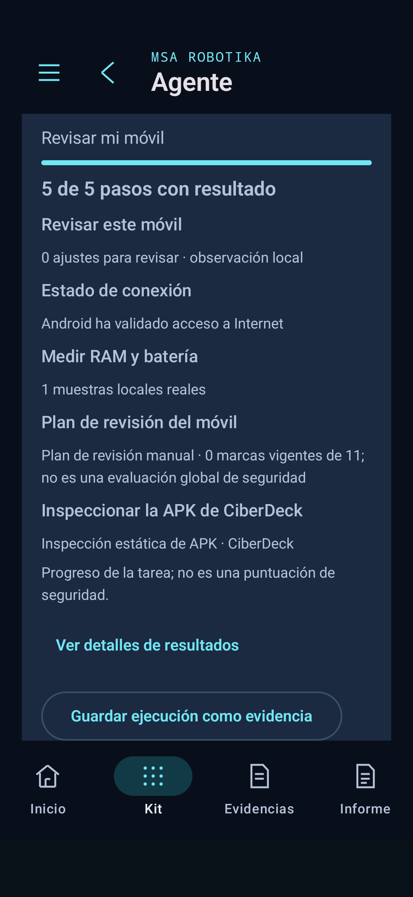

**Abre Agente → Revisar mi móvil**: ejecuta cinco comprobaciones reales de ajustes, conexión, recursos, plan de revisión y APK propia, sin cargar IA ni conectar el ESP32. Hay tareas directas para conexión, Bluetooth, NFC y APK. Las peticiones comunes reconocidas utilizan reglas locales; las peticiones más complejas pueden preparar un plan con el modelo local, cuya calidad sigue siendo experimental. No es comprensión general de cualquier instrucción.

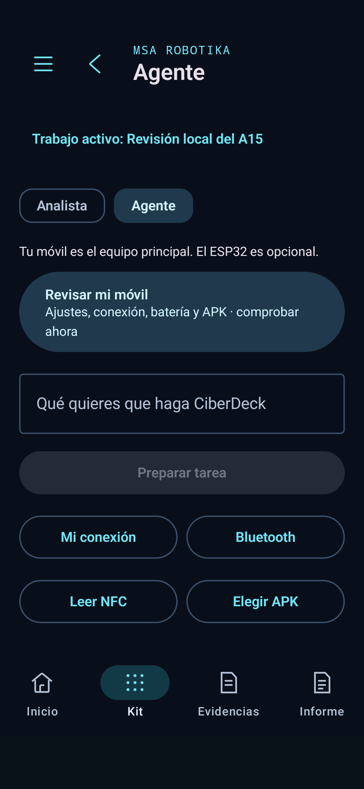 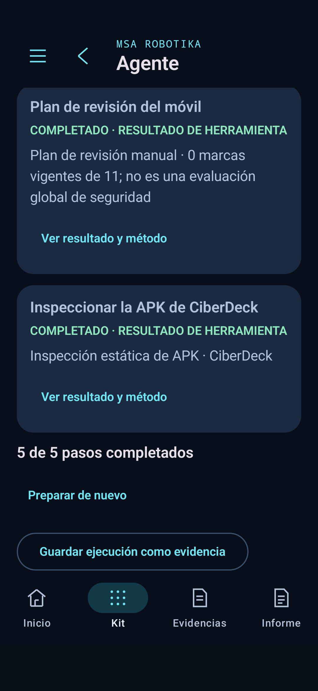

- **Agente local, desde Inicio → Abrir agente o Menú → Agente**: las 30 entradas cuentan con adaptador: 29 realizan operaciones implementadas y una consulta informa del hardware futuro. El ejecutor llama a los controladores reales de BLE, NFC, sensores, USB, diagnóstico, archivos, trabajos, informes, recepción y transferencia. Espera permisos, selección de archivos/adaptadores, interacción física y respuestas; no completa un paso por abrir una pantalla. Planes de hasta ocho pasos con IA local o selección manual, destinos autorizados, parada, resultados y registro. Un error o cancelación detiene los pasos posteriores. Conserva los límites de Android y los módulos RF/IR pendientes. [Operaciones y condiciones](docs/AGENT-ACTIONS.md) · [Pruebas y límites](docs/VALIDATION-019.md).
- **Comparación guiada**: prepara una pareja compatible entre hasta 100 diagnósticos recientes del filtro, comprueba sus copias y conserva la selección manual. Los detalles se despliegan y los selectores manuales se ocultan al preparar la pareja. El cálculo vuelve a verificar los originales.
- **Trabajos de auditoría**: separa cada revisión por nombre, alcance, objetivos y notas. Asocia los diagnósticos guardados al trabajo activo, incorpora evidencias existentes y exporta un informe con comprobación SHA-256. Archivar no borra archivos. Panel de integridad con recuentos medidos y accesos directos a las herramientas del trabajo activo. [Uso de trabajos](docs/VALIDATION-011.md) · [Panel y pruebas](docs/VALIDATION-012.md).
- **Comparar lecturas**: dos diagnósticos guardados del mismo tipo/destino, verificación SHA-256, gráfica de campos modificados/añadidos/ausentes/sin cambios, búsqueda y guardado vinculado al trabajo activo. Sin tráfico ni conclusiones automáticas de seguridad. [Método y validación](docs/VALIDATION-013.md).
- **Auditar un equipo**: flujo guiado desde el inicio. Resuelve un destino, confirma una IP y hasta ocho puertos, acepta el alcance autorizado y comprueba conexiones TCP sin enviar datos de aplicación. Gráfico de resultados, tiempos medidos, referencia temporal, comparación e informe verificable. La red queda fijada y un cambio interrumpe la prueba. Un puerto accesible no acredita una vulnerabilidad ni una intrusión.
- **Evidencia → IA**: adjunta un diagnóstico o comparación guardados, verifica su copia de nuevo antes de generar y conserva ID/SHA-256 de la fuente al guardar la interpretación. Preguntas rápidas editables, sin generación automática. [Flujo y validación](docs/VALIDATION-014.md).
- **Asistente IA local**: motor Google LiteRT-LM con Qwen3 0.6B mixed INT4, descargable sin registro. Importación privada, SHA-256, contexto elegido, parada y liberación de memoria. Generación comprobada físicamente en A15; calidad experimental y conclusiones sujetas a revisión. Los pesos no están incluidos en la APK ni Git. [Modelo exacto y pruebas](docs/OPEN-LOCAL-MODEL.md).
- **Campo magnético**: sensor Android real en µT, ejes X/Y/Z, gráfica, referencia temporal e informe. Requiere magnetómetro; no mide radiofrecuencia ni detecta ataques. El ESP32 necesita un sensor externo para medir por sí mismo.
- **Plan de red**: calculadora IPv4/CIDR, máscara, red, rango y direcciones utilizables; puede leer la IPv4 activa. Cálculo local sin escanear ni enviar tráfico.
- Inicio con acceso directo «Abrir agente» y herramientas organizadas. «Agente» tiene entrada visible en el menú lateral, título propio y acceso desde el kit. El analista conserva su pantalla «Asistente IA»; cambiar entre ambos conserva el plan preparado. Los ajustes del modelo se pliegan en el agente y el botón de carga sigue accesible. [Validación de navegación 0.19.1](docs/VALIDATION-0191.md).
- **Plan de revisión** dentro de Mi móvil: siguientes comprobaciones basadas en reglas locales, notas privadas, marcas manuales ligadas a la lectura y aviso cuando cambia. Gráfica de progreso manual e informe vinculado al trabajo activo; sin puntuación de seguridad ni generación de IA. [Uso y validación](docs/VALIDATION-015.md).
- **Mi móvil**: bloqueo, fecha del parche, depuración USB, conexión/VPN/DNS privado, RAM, almacenamiento, batería y hardware según las API públicas de Android.
- **Gráficas reales**: RAM y batería cada dos segundos al iniciarlas; máximo 60 muestras, pausa al salir. Sin muestras ficticias ni carga artificial de CPU.
- **Radar Wi-Fi**: canal determina el ángulo, RSSI el radio. No indica dirección física ni distancia. Usa la última lectura auténtica del ESP32; no es un flujo continuo.
- **BLE**: barras de RSSI de anuncios recibidos, sin inventar distancia ni seguimiento de personas.
- **Inspector APK**: hash SHA-256, certificados, permisos y componentes del manifiesto de un APK elegido, sin instalarlo ni ejecutarlo. Límite 128 MiB, sin reputación ni análisis de malware.
- **Inspector de enlaces**: inspección sintáctica sin conexión; HTTP, destino tras @, Unicode/punycode, IP, puerto y lista limitada de acortadores. Sin visitar la URL ni declarar que es segura.
- **Guardia de llamadas**, experimental: API oficial Android de filtrado con elección expresa de la app por el usuario. Registro privado limitado a 100 eventos entrantes, lista personal de revisión, avisos por coincidencia exacta o verificación de operador fallida. No consulta reputación externa, no graba ni bloquea llamadas. Sin llamada física de validación todavía.
- ESP32 con cinco pantallas horizontales y la misma paleta/identidad: Radar, Redes, Ficha, Avisos y USB. BOOT cambia de vista; no es táctil.

[Validación de esta candidata](docs/VALIDATION-019.md) · [Pruebas, límites y privacidad 0.8](docs/CIBERDECK-08.md) · [Contrato USB](docs/SUPERFLYPER-USB-PROTOCOL.md) · [Continuidad anterior](docs/SUPERFLYPER_WORK_HANDOFF.md).

PC→ESP y PC→OPPO funcionan por separado. Esto **no valida** la conexión directa Android→ESP mediante OTG, que sigue pendiente. El firmware real conserva el protocolo WiFi Sentinel; no se ha sustituido por el firmware genérico candidato.

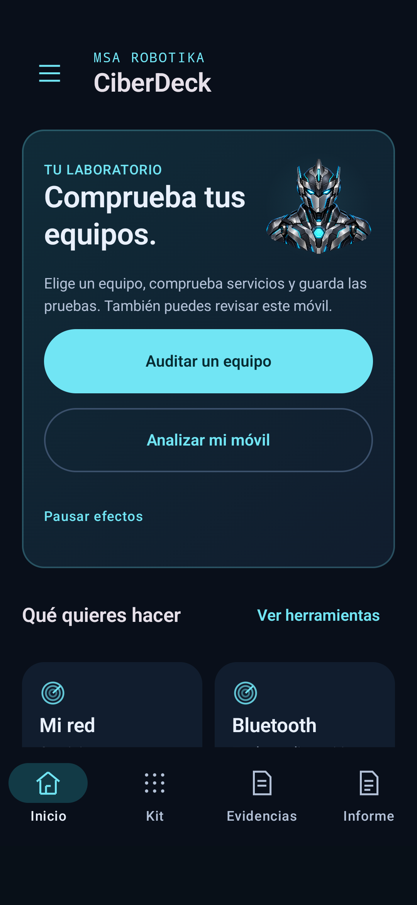 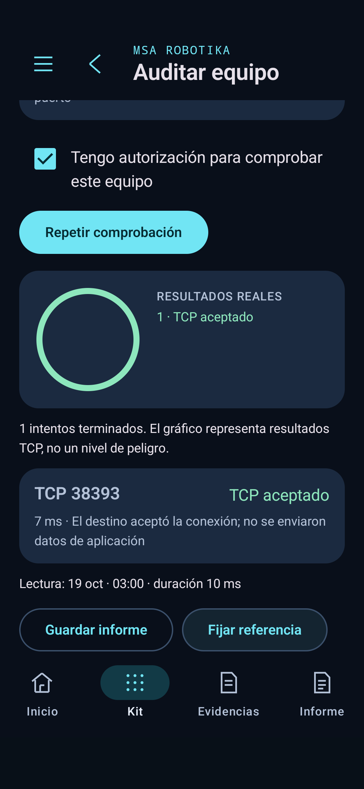 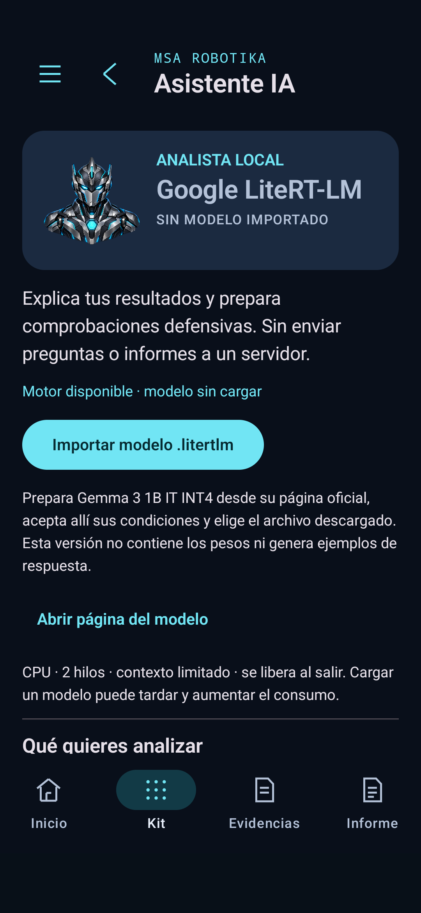

La captura de auditoría corresponde a una conexión real a un servicio local de prueba; no representa un incidente. Las pantallas proceden de la app ejecutada en el A15. El radar siguiente procede del framebuffer de la placa real.

Capturas actualizadas del A15: trabajo persistente con diagnósticos reales y gráfica de muestras del magnetómetro. La captura de IA muestra el modelo importado y descargado de memoria; la generación local se comprobó por separado.

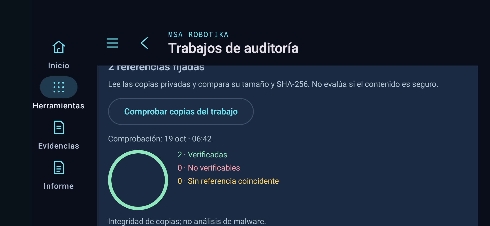 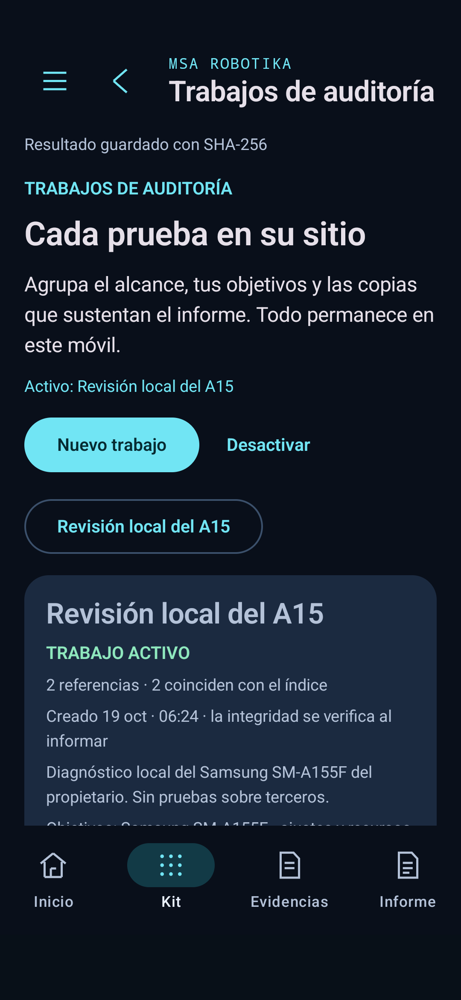 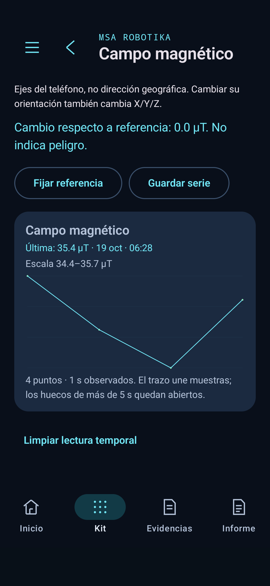

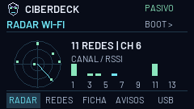

El rediseño ESP 0.3.1 conserva el radar inicial y cambia las otras cuatro vistas. **Compilado, aún sin instalar porque la placa no está detectada.** Vista previa del mismo código C con un snapshot anterior anonimizado, no una captura física nueva:

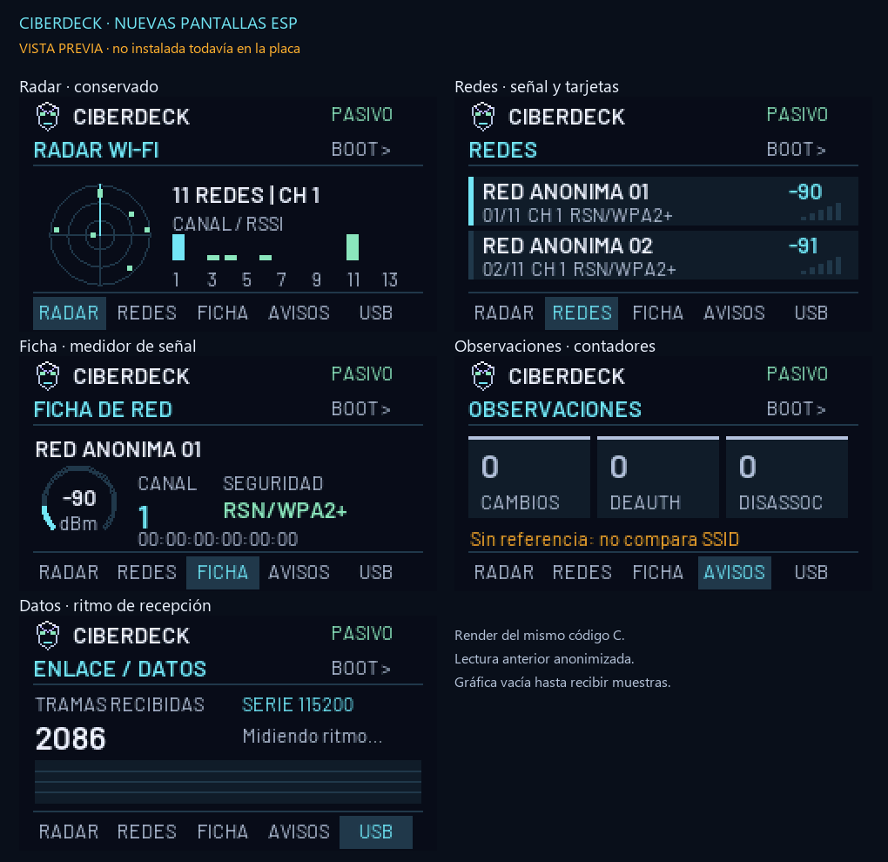

Pruebas de interfaz 0.15.1 correctas en A15: selección conservada tras recrear la actividad y volver a Comparar; gráfica calculada con dos diagnósticos reales y guardado en el trabajo activo; selección y retirada de contexto para IA sin borrar el original; plan de revisión guardado con su asociación al trabajo. La generación desde los botones de IA, las anotaciones manuales y el selector de exportación siguen pendientes de prueba en este recorrido.

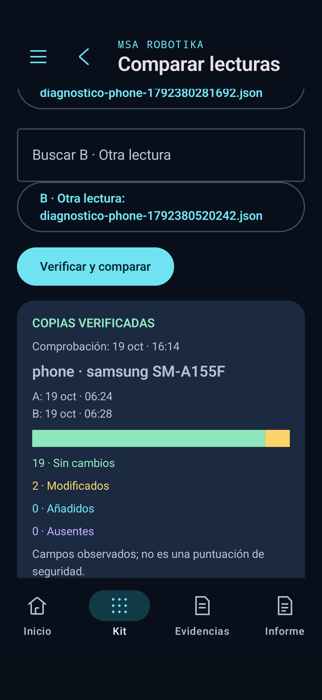 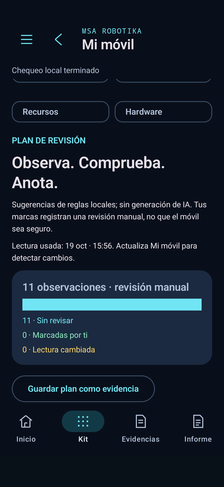 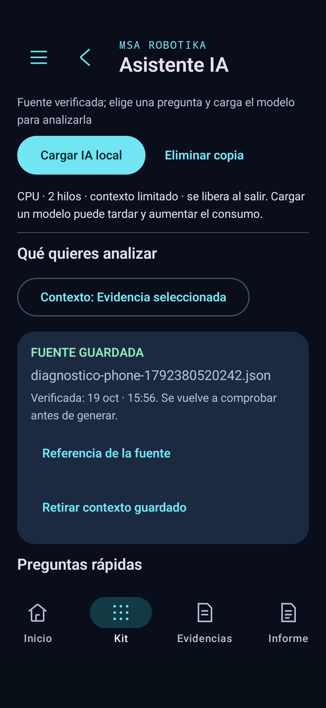

La selección guiada se comprobó con evidencias reales del A15. Captura de la pareja preparada; representa orden de guardado local, sin estimar riesgo:

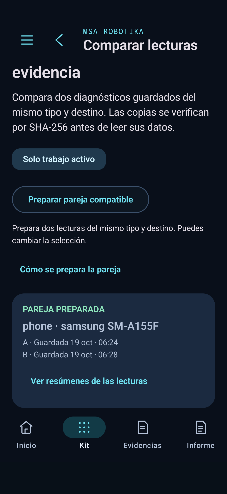

Capturas históricas de la versión 0.17 del agente en A15: petición y plan propuesto antes de ejecutar; resultados auténticos de móvil/conexión antes de guardar. Las capturas actuales de 0.19 aparecen a continuación. Los detalles de red permanecen plegados.

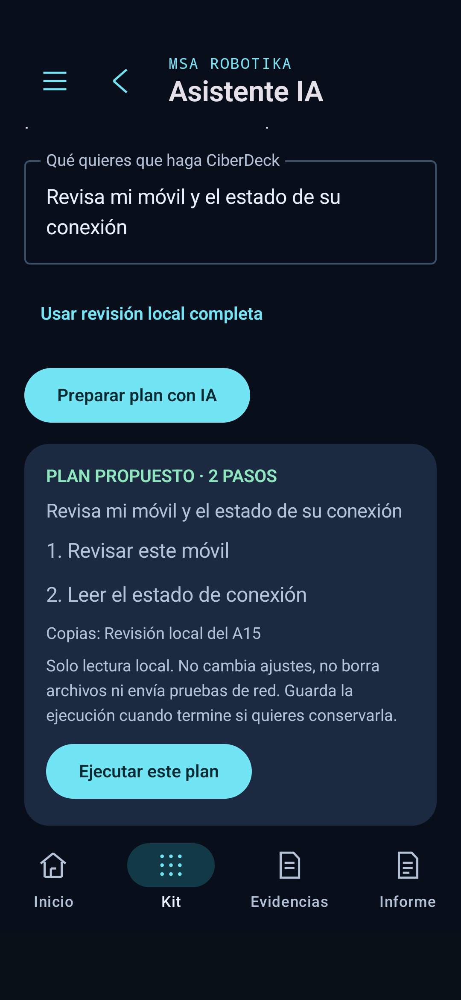 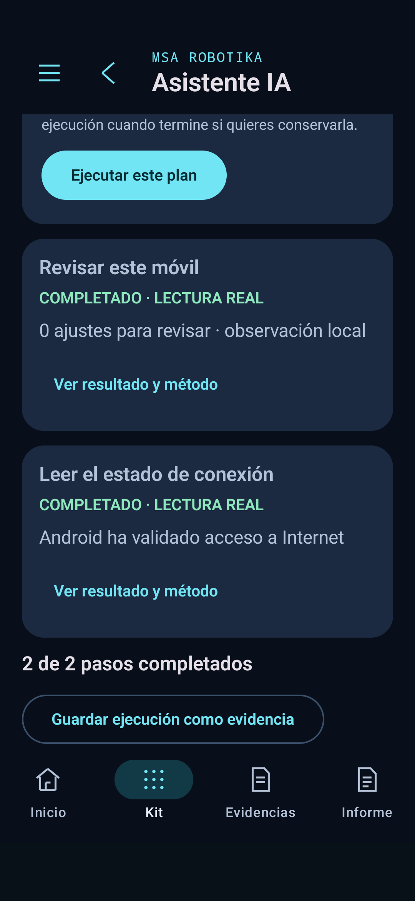

Capturas reales de 0.19: plan con IA antes de ejecutar, móvil/conexión completados y ejecución encadenada de cuatro operaciones. Detalles de red plegados; Módulos es una consulta de capacidades futuras, no una prueba RF.

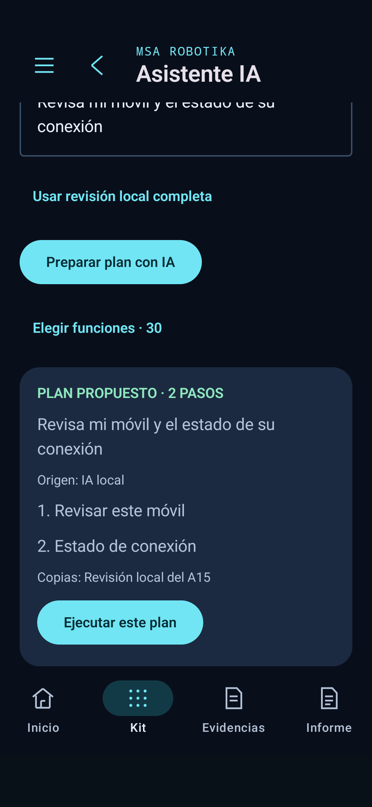 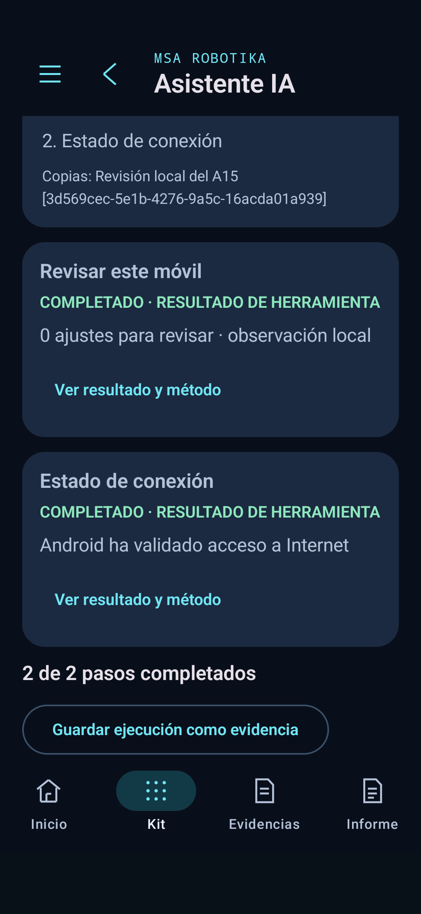 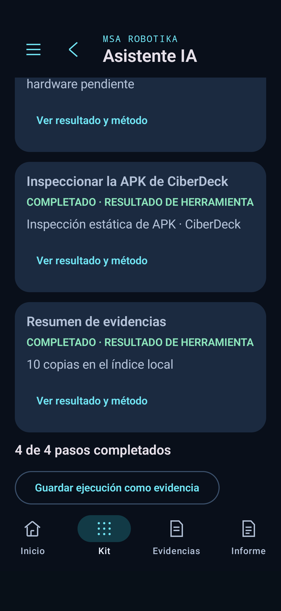

Entrada real de 0.19.1: acceso directo a «Agente». La captura de entrada se tomó antes de cargar el modelo.

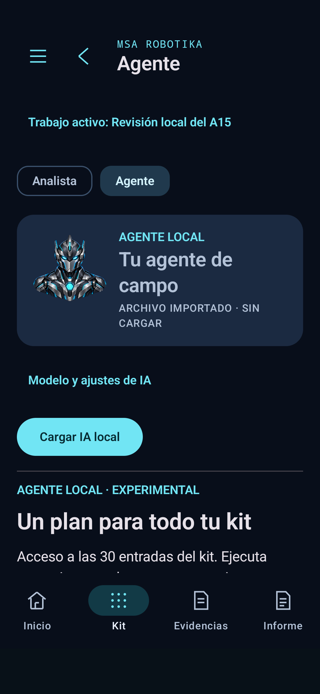

## Base CyberDeck conservada

Kit Android local para observar, comprobar y documentar auditorías autorizadas. Las funciones de la base 0.6 se mantienen en la candidata actual.

## Experiencia 0.6

Cuatro destinos permanentes: Inicio, Herramientas, Evidencias e Informe. El catálogo agrupa nueve herramientas con búsqueda. La portada Robotika muestra actividad real, acciones rápidas y efectos pausables. Las tarjetas de archivos priorizan abrir, exportar y gestionar; los detalles técnicos se despliegan cuando hacen falta.

El informe admite un borrador privado con nombre, alcance y notas del trabajo. Comprueba las copias antes de incluir diagnósticos y marca las alteradas como no verificadas. El borrador no es un gestor de casos ni una certificación de integridad.

La recepción HTTP local puede continuar al cambiar de aplicación durante su sesión limitada de dos minutos. Se aprueba cada archivo desde la app; detenerla, cerrar desde recientes o agotar el plazo cierra el receptor. Las notificaciones son opcionales. Consulta [archivos y límites](docs/FILES-AND-CLEANUP.md), [revisión de producto](docs/PRODUCT-AND-UX-REVIEW.md) y [validación de la experiencia](docs/VALIDATION-UX.md).

## Implementado en el código local

- Bluetooth: búsqueda BLE manual, RSSI y descubrimiento de servicios GATT autorizados, sin leer ni escribir características.
- NFC: identificador, tecnologías y contenido NDEF disponible; guardado de un informe, sin emulación de credenciales.
- Sesiones: transferencia directa entre móviles por TLS local, invitación temporal, aprobación y SHA-256.
- Mi red: descubrimiento manual de servicios DNS-SD/mDNS, resolución de anuncios y guardado como evidencia.
- Distribución gráfica de servicios web, impresión, multimedia y estaciones de trabajo observados.
- Portada con acciones directas y navegación fija al desplazarse.
- Estado real de conexión de Android: transporte, interfaz, direcciones y DNS configurados, sin escaneo ni ubicación.
- Diagnóstico DNS/IP y conexión TCP a un puerto elegido, sin envío de cargas.
- Revisión HTTP(S) mediante HEAD: certificado TLS, cabeceras y redirección sin seguirla automáticamente.
- Guardado de diagnósticos JSON como evidencia con SHA-256 e inclusión en el informe.
- Archivo de evidencias con búsqueda por nombre, fecha o hash, filtros y orden de guardado.
- Reapertura de informes guardados con verificación SHA-256 y comparación de dos observaciones NFC.
- Borrado confirmado de copias privadas, individual o de los resultados del filtro, con tamaño ocupado.
- Apertura de copias verificadas con un visor del móvil y exportación mediante el selector de destino; recepción visible en Evidencias al terminar.
- Recepción temporal desde navegador sin instalar CyberDeck en el remitente: HTTP local opcional, selección de un archivo y aprobación del receptor. Consulta [uso y límites](docs/FILES-AND-CLEANUP.md).
- Selección de archivos mediante el selector de Android.
- Copia a almacenamiento privado y cálculo SHA-256 durante la lectura.
- Índice persistente con identificador, nombre, tamaño y fecha de importación.
- Verificación posterior de las copias guardadas.
- Exportación de un informe Markdown mediante el selector de destino.
- Conector USB-serie para WiFi Sentinel: permiso Android, identificación del firmware, estado y redes observadas.
- Radar RSSI por canal y distribución de redes por canal a partir de la última lectura USB.
- Mascota original MSA Robotika con respiración, luces pulsantes e icono Android adaptativo.
- Firmware ESP32 complementario con cinco pantallas horizontales de 240 × 135 y controles BOOT.

La app arranca sin registros ni dispositivos simulados. Solo muestra radio tras una respuesta compatible del sensor. La pestaña Radio representa una lectura, no un flujo continuo; vuelve a leer desde USB para actualizar. El ángulo representa el canal observado: no se estima dirección ni distancia.

Mi red utiliza anuncios de servicios, no una lista completa de clientes del router. Las pruebas físicas y límites se documentan en [VALIDATION-LAN.md](docs/VALIDATION-LAN.md).

## Pendiente

Ampliar cobertura a otros móviles y validar el enlace USB móvil–ESP mediante OTG, validación física de etiquetas NDEF y más variantes BLE, importación estructurada de resultados de otras herramientas, PDF y VPN. El sensor físico se ha probado desde el PC. La imagen antigua cyberdeck-dashboard.png es una ilustración del primer prototipo.

La vista previa web está en preview/index.html. La captura docs/screenshots/esp-radar-horizontal.png procede del framebuffer real del ESP. La mascota se guarda en app/src/main/res/drawable-nodpi/cyberdeck_robot.png; consulta docs/ROBOT-DESIGN.md.

## Sensor físico

Placa ideaspark ESP32-D0WD con CH340 y pantalla ST7789 con perfil de 135 × 240, utilizada en horizontal (240 × 135). Pines MOSI 23, SCLK 18, CS 15, DC 2, RST 4, luz 32 y BOOT 0. Firmware basado en MSA WiFi Sentinel, identidad MSA-WiFi-Sentinel-0.3.0-CiberDeck. Trabaja en recepción Wi-Fi pasiva; BLE aún no se implementa.

BOOT corto: siguiente vista. Doble pulsación en Redes/Huella: siguiente red. Mantener en Radar: pausa/reanuda. Mantener en Huella abre una confirmación; otra pulsación larga guarda la referencia elegida. No guarda contraseñas. La app no modifica NVS ni flashea.

La copia de seguridad de la placa y las capturas con SSID/BSSID están en .private/ y se excluyen de Git. No se publican identificadores observados.

Los hashes permiten comparar las copias locales; la fecha depende del reloj del teléfono. No se afirma una cadena de custodia certificada. Al desinstalar la app se borran sus copias privadas: exporta previamente lo que necesites conservar.

## Compilación y pruebas

JDK 17, Gradle 8.9 y Android SDK 35. Las pruebas de lógica de 0.6 suman cincuenta casos: hash, sensor, diagnósticos, transferencia, archivo/NFC, recepción HTTP, QR y contexto del informe. El lanzador de pruebas de Gradle tiene un fallo de sockets locales en este PC; se ejecutan directamente con JUnitCore tras compilar los tests. La validación Android y sus límites se conserva en los documentos `docs/VALIDATION-*.md`; las pruebas del sensor están en [VALIDATION-SENSOR.md](docs/VALIDATION-SENSOR.md).

Las modificaciones de esta iteración se mantienen locales hasta completar la validación y revisión del propietario.

## Radios y transferencia local · 0.4.0-dev

Consulta [RADIOS-AND-PEER.md](docs/RADIOS-AND-PEER.md) para uso y límites, y [VALIDATION-RADIOS.md](docs/VALIDATION-RADIOS.md) para las pruebas. Esta versión permanece local.

La versión local 0.5.0-dev añade recepción desde navegador y limpieza de evidencias. Consulta [validación de archivos](docs/VALIDATION-FILES.md).
