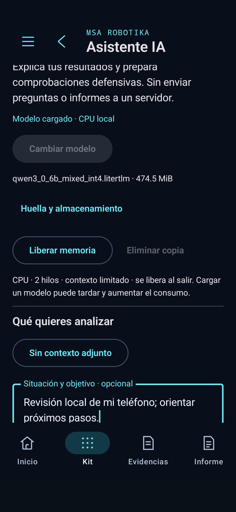
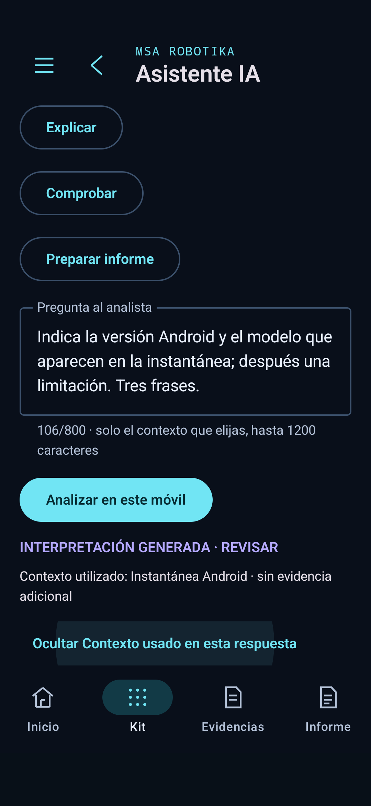

# CiberDeck 0.22 · Contexto local para la IA

## Implementado

El analista recibe la pregunta, la situación/objetivo que escribe el usuario, un resumen fechado del estado Android si está activada esa opción y la lectura o evidencia elegida. El resumen Android se obtiene al generar; incluye fabricante/modelo, Android, BLE, NFC, USB Host, VPN, DNS privado y batería, cuando Android los proporciona. Una capacidad anunciada no se interpreta como permiso concedido ni como conexión OTG comprobada.

Este resumen no incluye IP, SSID, credenciales ni identificadores únicos. Una evidencia seleccionada expresamente puede contener otros datos. «Incluir estado actual del móvil al generar» permite excluir la lectura Android; entonces el contexto declara que no hay lectura adjunta.

«Situación y objetivo» se identifica como declaración del usuario, no medición. El analista pide una respuesta breve con observaciones/fecha, interpretación justificada y siguiente comprobación. El contexto se limita para el modelo pequeño: entorno hasta 900 caracteres y lectura elegida hasta 1200; petición total inferior a 4000. No se añaden historial privado del teléfono, navegación web, mensajes o archivos sin seleccionar.

La entrada exacta enviada al motor, el contexto de entorno y sus SHA-256 se muestran junto a la respuesta y se conservan al guardar la interpretación. La vista previa de la lectura usa el mismo fragmento de hasta 1200 caracteres que se envía. La evidencia guardada se vuelve a verificar antes de generar. El hash permite identificar el texto utilizado; no acredita la veracidad de una medición.

El selector incluye «Resumen del agente»: una síntesis de la última sesión en memoria, con fechas y distinción de omisiones, confirmaciones manuales e interpretaciones de IA. No es una nueva lectura. El planificador recibe el estado Android ya observado en la sesión, si existe, con su fecha; no ejecuta nuevas comprobaciones para preparar un plan. Conserva ese contexto en la sesión y al guardar el informe. Los destinos y permisos siguen fuera de los argumentos del modelo.

## Ejemplo del taller y centro de transformación

Las peticiones sobre campos, radiación o transformadores muestran el alcance del instrumento y lo incorporan a la consulta. El magnetómetro Android y la serie de CiberDeck de hasta dos muestras por segundo no caracterizan exposición a 50 Hz, campo eléctrico ni dosis de radiación. El panel separador y las muestras del móvil no determinan el riesgo sanitario de los trabajadores.

La app puede organizar el contexto y documentar datos; la evaluación laboral corresponde al servicio de prevención con medición o cálculo adecuados, considerando fuentes, carga, frecuencias, distancias y puestos. Referencia contrastada: [guía técnica del INSST, edición 2019](https://www.insst.es/documentacion/catalogo-de-publicaciones/guia-tecnica-para-la-evaluacion-y-prevencion-de-los-riesgos-derivados-de-la-exposicion-a-campos-electromagneticos-en-los-lugares-de-trabajo-ano-2019). [Android documenta](https://developer.android.com/develop/sensors-and-location/sensors/sensors_position) el magnetómetro como sensor de campo magnético, no dosímetro. No se incorpora un cálculo de riesgo ni umbral sanitario inventado.

## Archivos principales

`AiContext.kt`, `AiPolicy.kt`, `LocalAiPanel.kt`, `LocalAiClient.kt`, `LocalAiService.kt`, `AgentPolicy.kt`, `AgentPanel.kt`, `AgentActionRuntime.kt`, `MainActivity.kt`, límites del informe magnético, versión Android y pruebas.

## Límites

El motor sigue siendo LiteRT-LM con el modelo local importado; no se ha entrenado un nuevo modelo ni añadido navegación o una base médica validada. Dar contexto mejora las entradas, pero no garantiza el razonamiento ni la exactitud de Qwen3 0.6B. Se comprueban transporte, fechas, selección, exclusión y generación, no competencia clínica o exactitud general.

Sin cambios de firmware. Continúan los pendientes físicos de OTG, sensores externos y módulos RF/IR. Solo está conectado el A15 durante esta revisión; el OPPO conserva su actualización anterior.

Rama de desarrollo y PR #1 en borrador. Sin main ni release. Modelo, APK y registros privados fuera de Git.

## Comprobaciones realizadas

- Compilación de app, pruebas y lint correctos. Última compilación completa: 2 min 4 s; recompilación posterior de la prueba diagnóstica: 28 s. Aviso de deprecación Android anterior conservado.
- 179 pruebas JVM correctas. Diez nuevas sobre contexto ausente, selección de campos, fecha/modelo, presupuesto, huella, separación entre lectura Android y evidencia adicional, contexto del plan y ejemplo del transformador.
- En el A15 se comprobaron quince regresiones de navegación, tareas, controladores, evidencia guardada y planificación con modelo real. El primer lote de la nueva consulta con contexto también pasó, pero su respuesta genérica motivó corregir el texto del prompt.
- Tras esa corrección, el lote específico de tres casos pasó (87,749 s) y trece regresiones adicionales pasaron (55,588 s).
- Al repetir los dieciséis casos sobre la APK final, quince pasaron y uno falló la comprobación literal de versión/modelo (112,185 s). La prueba no había conservado la respuesta antes del fallo, por lo que no se atribuye con certeza ese intento a un fallo de formato o del modelo.
- Se hizo robusta la comprobación frente a Markdown, espacios y puntuación, y se guardó la salida antes de comprobarla. El ensayo aislado con esa prueba pasó (70,126 s): incluyó Android 16/API 36, guardó la entrada y su huella, excluyó la lectura Android al desmarcarla y generó la respuesta al ejemplo declarado del taller. Registros privados `a15-022-context-diagnostic.txt` y `a15-022-release-candidate.txt` conservan ambos resultados.

Estas comprobaciones validan el cableado del contexto y recorridos de la app. No se presentan como una batería de razonamiento general infalible: la respuesta todavía mostró inferencias sin respaldo y confundió una fecha con una versión del sistema.

## Capturas reales

Capturas de la interfaz real, no mockups. La respuesta generada no se presenta como resultado clínico ni como una medición del taller.

## Hallazgo durante la prueba inicial

El primer lote pasó dieciséis pruebas de transporte, selección y generación. Al revisar la respuesta, el modelo dijo que no había datos aunque había una instantánea Android: confundió «sin evidencia adicional seleccionada» con ausencia global de observaciones. Ese lote no se considera una prueba de calidad de razonamiento.

Se corrigió la separación de las fuentes y se redujo la instrucción del analista. La prueba final exige además que la respuesta use al menos la versión Android o el modelo presentes en la instantánea real. La nota sobre límites sanitarios se muestra de forma determinista en la interfaz, además de enviarse al modelo; no depende de que Qwen siga bien las instrucciones.

## Calidad observada del modelo

La revisión de la respuesta final confirmó extracción de Android 16 y SM-A155F de la instantánea, pero también añadió inferencias sin respaldo sobre permisos y conexión de la app. En el ejemplo del taller generó afirmaciones no verificadas sobre una evaluación que no se había aportado. Esos textos no se consideran conclusiones comprobadas. Pasar la prueba de extracción no equivale a validar toda la respuesta ni razonamiento experto.

## Posible evolución a coordinador y especialistas

Idea discutida, todavía no implementada: un coordinador o «CEO» divide una misión y asigna contextos pequeños a especialistas de Android, redes, sensores y evidencias. Un único modelo local compartido puede atender esas tareas por turnos; las herramientas independientes podrían concurrir con límites. Cada trabajador debe devolver fuentes, resultados, errores y asuntos pendientes para que el coordinador no convierta hipótesis en hechos. Requiere más pruebas de fidelidad antes de ampliar autonomía. La 0.22 no anuncia un sistema multiagente terminado.

## APK local

Versión `0.22.0-ciberdeck-dev`, código 29.

- Ruta: `app/build/outputs/apk/debug/app-debug.apk`.
- Tamaño: 66132366 bytes.
- SHA-256: `5af3b1b1c17f3946353855a9d2b4b692a400f92370e312dd3e79e933adc0c65a`.
- Copias locales en `dist/`; actualización conservando los datos del paquete.

## Candidato de modelo para una fase posterior

Se comprobó la [ficha de Qwen3-1.7B de LiteRT Community](https://huggingface.co/litert-community/Qwen3-1.7B): Apache 2.0, sin acceso restringido en la API, variante INT4 de 977184032 bytes. La ficha actual pide LiteRT-LM 0.18 o posterior; esta app integra 0.13.1. No se ha descargado, importado ni anunciado compatibilidad con ese candidato. Antes de adoptarlo hacen falta migración del motor, respaldo del modelo actual y mediciones de memoria, latencia y fidelidad en el A15/OPPO. El aumento de tamaño no acredita competencia clínica.
