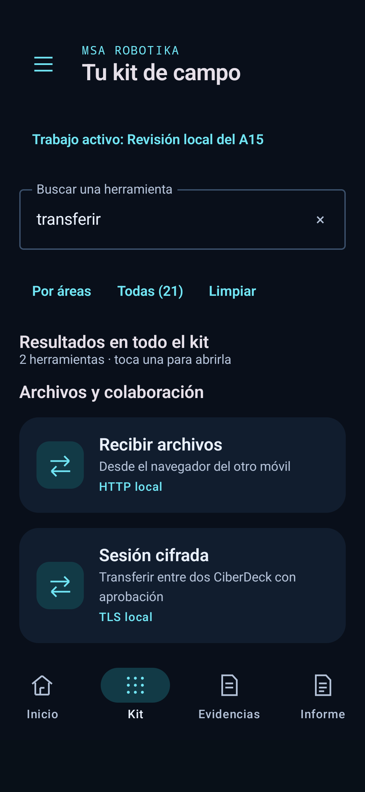
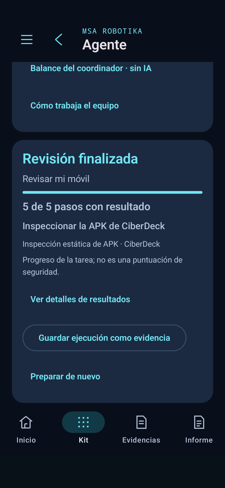

# CiberDeck 0.27 · Resultados antes que formularios

## Implementación

DNS/TCP y web muestran primero la última observación: tipo, resumen, destino y fecha de lectura. El guardado permanece visible; el formulario se conserva debajo con «Otra comprobación». No se ejecuta una consulta por abrir la pantalla, copiar o filtrar un resultado.

Los campos técnicos quedan plegados inicialmente. Se pueden abrir y buscar por nombre o contenido, sin distinguir mayúsculas ni acentos; todas las palabras introducidas deben coincidir. Se conservan el orden original y los campos con nombres repetidos. «Mostrar todos los campos» retira la búsqueda. El recuento es de campos, no una puntuación de seguridad.

«Guardar resultado como evidencia» recibe siempre el `DiagnosticResult` completo original, aunque haya un filtro activo. «Copiar resumen» conserva tipo, destino, fecha y resumen, y avisa que no incluye los campos técnicos. Android 13 o posterior recibe la marca de contenido sensible del portapapeles; esto no impide que otras aplicaciones lean contenido según los permisos y restricciones del sistema. La app no lee el portapapeles, abre enlaces ni comparte nada por red al copiar.

Una nueva observación reinicia el desplegable, la consulta y el mensaje de copia. No se arrastran a una lectura diferente. No cambia la resolución DNS, las consultas TCP/HEAD, validación TLS, permisos ni almacenamiento de evidencias. Las limitaciones de cada comprobación permanecen en la herramienta y en sus campos de método.

El diagnóstico pasa al `ViewModel` de sesión para conservarse cuando Android recrea la actividad, como ocurre en una rotación. No equivale a guardarlo: terminar el proceso o cerrar la sesión puede perderlo; hay que usar el guardado para conservar una evidencia. Al recibirse una observación en red/web la lista vuelve al inicio para presentar el resultado.

## Archivos

- `DiagnosticPresentation.kt`: búsqueda sobre los campos originales y texto del resumen.
- `DiagnosticResultCard.kt`: presentación, búsqueda, guardado y copia mediante callbacks.
- `DiagnosticsPanel.kt`: integración en red/web y escritura explícita del resumen al portapapeles.
- `DiagnosticPresentationTest.kt`: filtros, duplicados, orden, origen y alcance del resumen.
- `DiagnosticResultCardDeviceTest.kt`: dos pruebas aisladas de UI con fixtures explícitos, sin portapapeles real, evidencias o red.
- `DeviceWorkflowTest.kt`: expectativa final de inicio adaptada al identificador estable del botón desde 0.25.
- `DeckSessionModel.kt`, `MainActivity.kt`: retención en memoria del diagnóstico y posición de la lista al llegar una lectura.
- `DiagnosticNavigationDeviceTest.kt`: ensayo preparado con resolución real de la dirección loopback y recreación de actividad, sin evidencias guardadas ni destinos externos.

## Validación

- Compilación final de aplicación, instrumentación y pruebas Kotlin correcta en **2 min 30 s**; candidata anterior correcta en 3 min 14 s antes del cambio de retención y posición. Lint: cero errores/fatales, **24 avisos y 1 sugerencia**, como en 0.26. Se mantienen los avisos de API/Gradle.
- **216 pruebas JVM correctas**, con seis casos nuevos de búsqueda, conservación de duplicados/orden, filtro vacío o sin coincidencias y procedencia/alcance del resumen copiado.
- Aplicación 0.27.0-ciberdeck-dev, código 34, y APK de pruebas instaladas mediante actualización en Galaxy A15 SM-A155F Android 16: ambas `Success`. Versión comprobada mediante Android. Solicitud de arranque aceptada; sin `FATAL EXCEPTION` en el registro del proceso consultado. No demuestra la presentación bajo bloqueo ni la ausencia de otros defectos.
- **Validación física realizada el 20 de octubre de 2026** tras desbloquear el A15. Se ejecutaron 16 casos distintos: catálogo/áreas/búsqueda (3), foco del agente (2), recientes/guía NFC (1), tarjeta de resultados (2), navegación DNS/recreación (1), tareas reales del móvil (4) y navegación agente/analista (3). Primera ronda: 15 correctos y un fallo en una expectativa antigua del ensayo de navegación, que exigía el formulario abierto aun teniendo un plan. Se actualizó el helper para comprobar la vista enfocada y se repitieron los tres casos que lo usan más el diagnóstico DNS con captura: **4/4 correctos en 15,345 s**. Los 16 casos tienen resultado correcto tras ese ajuste; no se presenta como una única ronda 16/16. La primera ronda duró 49,317 s.
- Los fixtures explícitos se usaron solo para controles de tarjeta y selección de plan. No se guardan, no escriben el portapapeles real y no se publican como mediciones. La tarea del móvil usa resultados reales de Android sin modelo cargado. La prueba DNS resuelve `127.0.0.1`, comprueba la presentación y conserva el mismo diagnóstico al recrear la actividad; no valida Internet externo. No se ha probado en esta ronda copiar al portapapeles real ni se certifica el guardado en disco con el ensayo aislado de la tarjeta: este comprueba que el callback recibe el objeto original completo pese al filtro.
- Los únicos cambios posteriores a la APK fueron en instrumentación y documentación: expectativa del formulario plegado y captura del diagnóstico real. Instrumentación recompilada e instalada, lint correcto, en 45 s. La APK de producción, sus bytes y SHA-256 indicados abajo permanecen iguales. Registros privados de rondas: `a15-027-ux-first.txt` y `a15-027-ux-followup.txt`.
- Cinco PNG de 1080 × 2340 obtenidos de la app en el A15 y revisados visualmente: inicio, áreas, búsqueda global de «transferir», tarea real del móvil y DNS loopback. Los nombres privados de algunas capturas conservaban el sufijo 025 del ensayo; al exportarlas se identifican como **027**, la versión que se ejecutó. No se sobrescriben capturas históricas ni se usan renders o fixtures para estos PNG.
- OPPO no conectado ni actualizado. Firmware, modelo local, permisos y datos guardados no se modifican. La instalación preserva el paquete y sus datos privados.

APK final: **66.261.632 bytes**, SHA-256 `b7df00422136f1531379c65604c64428eb39ef82b8092692eb4ab5a02ea0d09e`. Copias y huellas de `dist/` actualizadas. Registros de instalación/arranque en `.private/android-validation/a15-027-install.json` y `a15-027-runtime-private.txt`, fuera de Git junto con APK y modelo. Sin release ni fusión en main.

Pendiente de otras rondas: validación en OPPO y conexión USB OTG física, pruebas de sensores/etiquetas concretos, transferencia con el otro móvil y generación de IA sobre esta revisión. La comprobación de navegación no valida por sí sola todos esos controladores. El alcance de esta ronda es interfaz y sesión en el A15.

  

 
